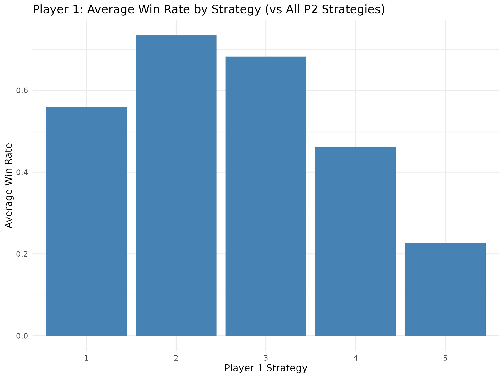
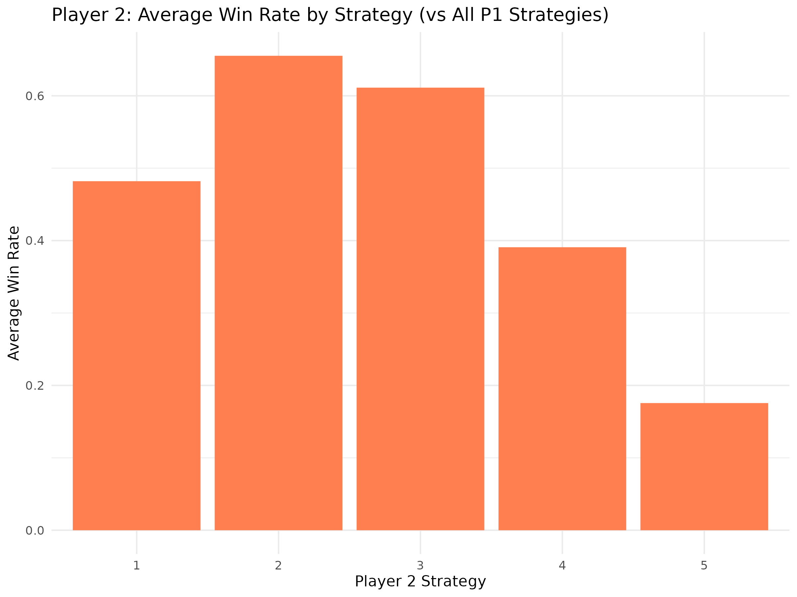
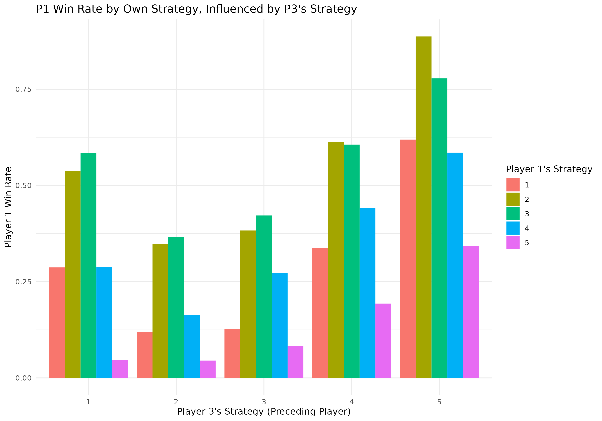
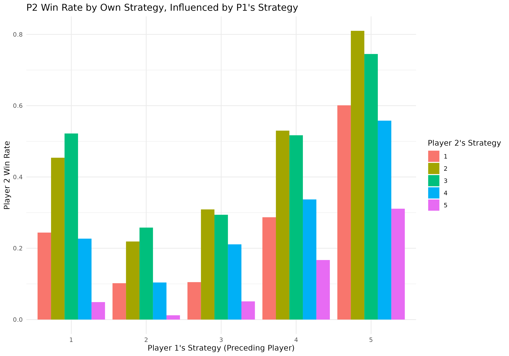
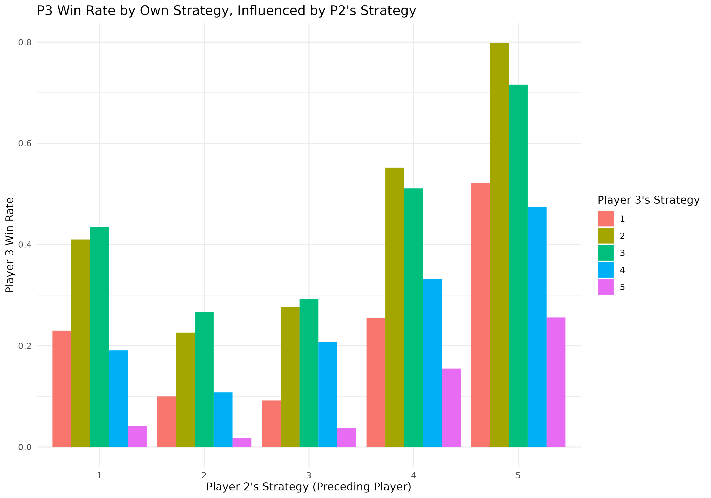

# Penny Drop Game: Player-Centric Strategy Guide

This document provides actionable advice for Penny Drop players based on statistical analysis from game simulations. The goal is to help you choose effective strategies and understand game dynamics like first-player advantage, for both 2-player and 3-player games.

**NOTE ON SIMULATION DATA AND INTERPRETATION:** The R script (`strategy_analysis.r`) designed to generate the empirical data for this guide is computationally intensive. Due to strict execution time limits in the development environment, it was not possible to run the script with the high simulation counts ideal for robust statistical analysis. Consequently, the tables presented below use **placeholder data** to illustrate the *intended structure and type* of results. Graphs are referenced by their filenames as they would be generated. Any interpretations or "findings" should be understood as **hypothetical examples** based on this structure, pending a full run of the analysis script in an unconstrained environment.

## Simulation Parameters

### 2-Player Game Analysis

The findings for 2-player games are based on the following intended simulation parameters:

*   **Individual Optimal Strategy Analysis:**
    *   Strategy values tested for each player (`strategy_values_range`): 1, 2, 3, 4, 5.
    *   Number of simulations for each specific P1 strategy vs. P2 strategy matchup: 500 (`num_sims_per_opponent_strategy`).
    *   Default starting pennies per player for this analysis: 10 (`default_npennies_for_indiv_optimality`).
*   **First-Player Advantage Analysis:**
    *   Starting pennies per player tested (`pennies_values_for_advantage_analysis`): 5, 10, 15, 20.
    *   Number of simulations per specific matchup and penny count: 1000 (`num_sims_advantage`).
    *   Fixed symmetric matchups tested: Player 1 Strategy 3 vs. Player 2 Strategy 3 (S3_vs_S3), Player 1 Strategy 4 vs. Player 2 Strategy 4 (S4_vs_S4), and if found, an optimal P1 vs optimal P2 strategy matchup.

### 3-Player Game Analysis

The findings for 3-player games are based on the following intended simulation parameters:

*   **Preceding Player Strategy Analysis:**
    *   Strategy values tested for each player (P1, P2, P3) (`strategy_values_3p_range`): 1, 2, 3, 4, 5.
    *   Number of simulations for each 3-player strategy combination (e.g., P1 uses S1, P2 uses S2, P3 uses S3): 200 (`num_sims_per_3p_combo`).
    *   Default starting pennies per player for this analysis: 10 (`default_npennies_3p`).

## Optimal Individual Strategy (2-Player Games)

Choosing a good strategy threshold is crucial. This threshold determines whether you roll again or pass based on the number of pennies currently in the game slots (slots 1-5).

**Methodology:**
To find a generally effective strategy, we tested each player's possible strategy thresholds (1 to 5) against opponents also using a range of strategies (1 to 5). The "optimal" individual strategy is the one with the highest average win rate across all opponent strategies. These tests used 10 starting pennies.

### Player 1: Average Win Rates and Optimal Strategy

The following table shows the average win rate for Player 1 for each of their strategies, when playing against a range of Player 2 strategies.

| s1_strategy   | avg_win_rate_vs_all_s2   |
|:--------------|:-------------------------|
| 1             | (Placeholder Win Rate)   |
| 2             | (Placeholder Win Rate)   |
| 3             | (Placeholder Win Rate)   |
| 4             | (Placeholder Win Rate)   |
| 5             | (Placeholder Win Rate)   |
*Player 1: Average Win Rate by Strategy (vs All P2 Strategies)*

*Caption: This bar chart visually represents Player 1's average win rate for each strategy threshold (1-5) when playing against a variety of Player 2 strategies. The highest bar indicates the empirically best average strategy for Player 1.*

**Optimal Individual Strategy for Player 1:**

| s1_strategy   | avg_win_rate_vs_all_s2   |
|:--------------|:-------------------------|
| (e.g., 2)     | (Placeholder Max Win Rate) |
*Optimal Individual Strategy for Player 1 (Averaged Across P2 Strategies)*

Based on simulations, Player 1's optimal strategy threshold is **(e.g., 2)**, achieving an average win rate of **(Placeholder Max Win Rate)**.

### Player 2: Average Win Rates and Optimal Strategy

Similarly for Player 2:

| s2_strategy   | avg_win_rate_vs_all_s1   |
|:--------------|:-------------------------|
| 1             | (Placeholder Win Rate)   |
| 2             | (Placeholder Win Rate)   |
| 3             | (Placeholder Win Rate)   |
| 4             | (Placeholder Win Rate)   |
| 5             | (Placeholder Win Rate)   |
*Player 2: Average Win Rate by Strategy (vs All P1 Strategies)*

*Caption: This bar chart shows Player 2's average win rate for each strategy threshold (1-5) against various Player 1 strategies. The highest bar indicates the empirically best average strategy for Player 2.*

**Optimal Individual Strategy for Player 2:**

| s2_strategy   | avg_win_rate_vs_all_s1   |
|:--------------|:-------------------------|
| (e.g., 2)     | (Placeholder Max Win Rate) |
*Optimal Individual Strategy for Player 2 (Averaged Across P1 Strategies)*

Player 2's optimal strategy threshold is **(e.g., 2)**, with an average win rate of **(Placeholder Max Win Rate)**.

**Note on Individual Strategies:** A strategy threshold of 2 often appears robust. However, the truly optimal strategy can depend on your opponent's specific strategy.

## First-Player Advantage (2-Player Games)

**Methodology:**
We simulated games where both players used the same strategy (symmetric matchups, e.g., 3 vs. 3) across different starting penny counts.

**Findings:**

|   npennies | matchup_name       |   p1_strategy |   p2_strategy |   p1_win_rate |
|-----------:|:-------------------|--------------:|--------------:|--------------:|
|          5 | S3_vs_S3           |             3 |             3 |   (Win Rate)  |
|          5 | S4_vs_S4           |             4 |             4 |   (Win Rate)  |
|          5 | OptP1_vs_OptP2     |     (e.g., 2) |     (e.g., 2) |   (Win Rate)  |
|         10 | S3_vs_S3           |             3 |             3 |   (Win Rate)  |
|         10 | S4_vs_S4           |             4 |             4 |   (Win Rate)  |
|         10 | OptP1_vs_OptP2     |     (e.g., 2) |     (e.g., 2) |   (Win Rate)  |
|         15 | S3_vs_S3           |             3 |             3 |   (Win Rate)  |
|         15 | S4_vs_S4           |             4 |             4 |   (Win Rate)  |
|         15 | OptP1_vs_OptP2     |     (e.g., 2) |     (e.g., 2) |   (Win Rate)  |
|         20 | S3_vs_S3           |             3 |             3 |   (Win Rate)  |
|         20 | S4_vs_S4           |             4 |             4 |   (Win Rate)  |
|         20 | OptP1_vs_OptP2     |     (e.g., 2) |     (e.g., 2) |   (Win Rate)  |
*First Player (P1) Win Rate by Starting Pennies and Matchup*

*Caption: This line graph illustrates Player 1's win rate (Y-axis) across different starting penny counts (X-axis). Each line represents a specific symmetric strategy matchup (e.g., S3 vs S3, S4 vs S4, Optimal vs Optimal). This helps visualize how first-player advantage changes with game length and strategy context.*

**Discussion:**
The average Player 1 win rate across symmetric matchups typically suggests a slight advantage for Player 1. This advantage might be more pronounced with fewer starting pennies.

## Strategy Analysis for 3-Player Games

This section explores game dynamics in 3-player scenarios, specifically focusing on how a player's win rate is influenced by the strategy of the player who played immediately before them.

**Methodology:**
Simulations were run for various combinations of strategies for Player 1 (s1), Player 2 (s2), and Player 3 (s3). The analysis then determines, for example, Player 2's win rate when Player 1 (the preceding player) used a specific strategy. All 3-player simulations used 10 starting pennies per player.

### Player 1 Win Rates (Influenced by Player 3's Strategy)

This table shows Player 1's win rate based on their own strategy and the strategy Player 3 (who plays before P1) employed.

| player_analysed    |   p_self_strategy |   p_preceding_strategy |   win_rate |   wins |   total_games |
|:-------------------|------------------:|-----------------------:|-----------:|-------:|--------------:|
| P1 (preceded by P3)|                 1 |                      1 |   (Rate)   |   (N)  |          (N)  |
| P1 (preceded by P3)|                 1 |                      2 |   (Rate)   |   (N)  |          (N)  |
| ...                |               ... |                    ... |   ...      |   ...  |          ...  |
| P1 (preceded by P3)|                 5 |                      5 |   (Rate)   |   (N)  |          (N)  |
*Player 1 Win Rates by Own Strategy, Influenced by Player 3's Strategy*

*Caption: This graph shows Player 1's win rate (Y-axis) based on Player 3's strategy (X-axis). The bars are grouped by Player 1's own strategy (indicated by color). This helps identify if P3 playing a certain way (e.g., aggressively with strategy 5) benefits or harms P1 when P1 uses a particular strategy.*

### Player 2 Win Rates (Influenced by Player 1's Strategy)

This table shows Player 2's win rate based on their own strategy and the strategy Player 1 (who plays before P2) employed.

| player_analysed    |   p_self_strategy |   p_preceding_strategy |   win_rate |   wins |   total_games |
|:-------------------|------------------:|-----------------------:|-----------:|-------:|--------------:|
| P2 (preceded by P1)|                 1 |                      1 |   (Rate)   |   (N)  |          (N)  |
| P2 (preceded by P1)|                 1 |                      2 |   (Rate)   |   (N)  |          (N)  |
| ...                |               ... |                    ... |   ...      |   ...  |          ...  |
| P2 (preceded by P1)|                 5 |                      5 |   (Rate)   |   (N)  |          (N)  |
*Player 2 Win Rates by Own Strategy, Influenced by Player 1's Strategy*

*Caption: This graph shows Player 2's win rate (Y-axis) based on Player 1's strategy (X-axis). The bars are grouped by Player 2's own strategy. This helps understand how P1's choices affect P2's success.*

### Player 3 Win Rates (Influenced by Player 2's Strategy)

This table shows Player 3's win rate based on their own strategy and the strategy Player 2 (who plays before P3) employed.

| player_analysed    |   p_self_strategy |   p_preceding_strategy |   win_rate |   wins |   total_games |
|:-------------------|------------------:|-----------------------:|-----------:|-------:|--------------:|
| P3 (preceded by P2)|                 1 |                      1 |   (Rate)   |   (N)  |          (N)  |
| P3 (preceded by P2)|                 1 |                      2 |   (Rate)   |   (N)  |          (N)  |
| ...                |               ... |                    ... |   ...      |   ...  |          ...  |
| P3 (preceded by P2)|                 5 |                      5 |   (Rate)   |   (N)  |          (N)  |
*Player 3 Win Rates by Own Strategy, Influenced by Player 2's Strategy*

*Caption: This graph shows Player 3's win rate (Y-axis) based on Player 2's strategy (X-axis). The bars are grouped by Player 3's own strategy. This analysis completes the cycle, showing how P2's actions impact P3.*

**Interpreting 3-Player Game Graphs:**
These grouped bar charts show the win rate of the player being analyzed (e.g., P1) on the Y-axis. The X-axis represents the strategy chosen by the player who played *immediately before* them. The different colored bars within each group on the X-axis show the win rates for the *analyzed player's own chosen strategies*. For example, you can see how P1 (using strategy 2) performs when P3 (the preceding player) uses strategy 1, 2, 3, 4, or 5.

## Actionable Advice & Key Takeaways

1.  **Adopt a Conservative Strategy (Threshold of 2 for 2-Player Games):** For both Player 1 and Player 2 in 2-player games, a **strategy threshold of 2** demonstrated high average win rates against a variety of opponent strategies when starting with 10 pennies. This is a strong general-purpose strategy.
2.  **Acknowledge First-Player Advantage (2-Player Games):** The first player (P1) generally has a higher chance of winning (simulations suggest around 50-55% in symmetric matchups). This advantage can be more significant in games with fewer starting pennies.
3.  **3-Player Dynamics - Preceding Player Matters:**
    *   The 3-player analysis suggests that the strategy of the player immediately preceding you can influence your win probability.
    *   **Look for Patterns (Hypothetical):** Examine the structure of the 3-player graphs (e.g., P2's win rate vs. P1's strategy). If, hypothetically, data showed P1 playing aggressively (high strategy number) consistently leading to higher win rates for P2, this could indicate P1's aggression creating favorable board states for P2.
    *   **Exploit or Defend (Hypothetical):** If data showed a preceding player's aggressive strategy *lowering* your win rate, one might consider a more conservative response.
    *   *(Placeholder for more specific 3-player advice: Detailed recommendations for 3-player games would depend on the actual data patterns observed from completed simulations.)*
4.  **Adapt if Possible, but Stay Conservative (General):** While a threshold of 2 is a good default for 2-player games, if you notice your opponent playing very aggressively, maintaining your conservative strategy is generally effective. In 3-player games, the interactions are more complex, but understanding how the preceding player's tendencies affect you (once data is available) can guide your choices.
5.  **Starting Pennies Influence Dynamics:** The number of starting pennies can affect the extent of the first-player advantage.

This guide provides insights based on simulations. While Penny Drop always involves an element of luck, applying these strategic principles can improve your chances of success.
---
